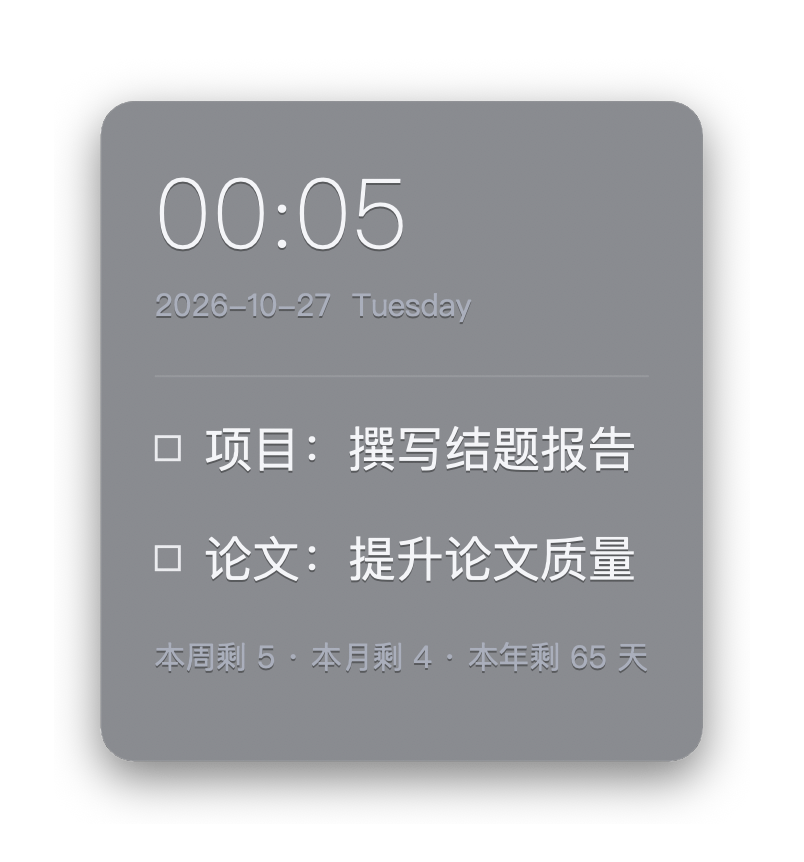

<h1 align="center">DesktopTip</h1>

<p align="center"><b>把待办与便签钉在桌面上的轻量工具</b></p>
<p align="center">一个纯文本文件，一张半透明卡片：时钟、日期、待办和倒计时，始终在桌面上。</p>

<p align="center">
  <b>简体中文</b> · <a href="README_EN.md">English</a>
</p>

<p align="center">
  <a href="https://github.com/XYoung1201/Desktop-Tips/releases/latest"><b>下载 Windows / macOS 版</b></a> ·
  <a href="#快速上手"><b>快速上手</b></a> ·
  <a href="#todotxt-写法"><b>TODO 写法</b></a> ·
  <a href="https://github.com/XYoung1201/Desktop-Tips/issues"><b>问题反馈</b></a>
</p>

<p align="center">
  
  
  
  
</p>

<p align="center">
  
</p>
<p align="center"><sub>macOS 版卡片：大字时钟、灰色日期、可勾选的待办，以及自动计算的剩余天数。</sub></p>

DesktopTip 是一个常驻桌面的便签 / 待办小工具。它读取一个普通文本文件（默认 `TODO.txt`），把内容渲染成一张半透明的圆角卡片，贴在桌面上。你用任何编辑器改文件，卡片就跟着更新；点一下复选框，就把这条待办标为完成；用 `##` 分类、`@时间` 设截止，平时安静待在桌面，临近截止才轻轻浮上来。

它适合把当天最重要的几件事、倒计时和日期信息放在眼前：没有账号、没有云端、没有数据库，内容就是你自己的一个 `.txt` 文件。Windows 与 macOS 各有一份原生实现，**共用同一种 TODO 文件格式和同一套配置键**，同一个文件可以在两台电脑之间同步使用。

## 目录

- [产品特性](#产品特性)
- [平台与下载](#平台与下载)
- [快速上手](#快速上手)
- [TODO.txt 写法](#todotxt-写法)
- [分类：折叠、隐藏与单独显示](#分类折叠隐藏与单独显示)
- [截止时间与倒计时](#截止时间与倒计时)
- [显示模式与智能浮现](#显示模式与智能浮现)
- [界面与操作](#界面与操作)
- [配置说明](#配置说明)
- [两个平台的差异](#两个平台的差异)
- [常见问题](#常见问题)
- [从源码构建](#从源码构建)
- [反馈与贡献](#反馈与贡献)

## 产品特性

| 特性 | 可以做什么 | 带来的价值 |
|---|---|---|
| 纯文本驱动 | 用任意编辑器维护 `TODO.txt`，卡片自动刷新 | 内容完全在自己手里，可放进网盘或版本管理 |
| 多级分类 | `##` 一级、`###` 二级……可无限嵌套；分类可折叠（`_FOLD`）、隐藏（`_HIDE`），单个任务可用 `_SHOW` 在分类收起时仍单独显示 | 事情再多，卡片上也只留眼下要看的几行 |
| 一键勾选 | 点圆形复选框即在行尾加 / 去 `_OK`，任务**原位不动**（可选「已完成项沉底」） | 不打开文件就能完成待办，文件仍是可读的纯文本 |
| 截止时间倒计时 | 任务或独立倒计时都可设截止时间：按「年月日时分秒」选时刻，或按「剩余几月几天几时几分几秒」输入，二者可切换；都换算成 `@YYYY-MM-DD HH:MM:SS` 写进文件 | 倒计时就是文件里的一段文字，换电脑、重启都不丢 |
| 智能浮现 | 平时附着桌面不打扰；临近截止或定时扫一眼时，卡片以半透明、点击穿透的轻浮层浮到最上面 | 解决“置顶太打扰、不置顶看不到”的两难 |
| 动态占位符 | `{{TIME}}`、`{{DATE}}`、`{{DAYS_LEFT_YEAR}}` 等渲染时替换为实时信息 | 一张卡片同时是时钟、日历和进度提醒 |
| 简约卡片 | 半透明圆角、柔和阴影与顶部高光；细线图标、极简计时胶囊；字号、行距、颜色与字体可调 | 融入壁纸，不抢眼也看得清 |
| 位置记忆 | 拖动卡片到任意位置，重启后恢复 | 一次摆放，长期有效 |

## 平台与下载

| 平台 | 系统要求 | 获取方式 |
|---|---|---|
| macOS | macOS 13 及以上，Apple 芯片与 Intel 通用 | 在 [Releases](https://github.com/XYoung1201/Desktop-Tips/releases/latest) 下载 `DesktopTip-macOS.zip`，解压后打开 `DesktopTip.app` |
| Windows | Windows 10 / 11，x64 | 在 [Releases](https://github.com/XYoung1201/Desktop-Tips/releases/latest) 下载 `DesktopTip-windows-x64.zip`，解压后运行 `DesktopTip.exe`；也可自行编译，见[从源码构建](#从源码构建) |

macOS 版为临时（ad-hoc）签名。首次启动如被系统拦截，请在访达中**右键 → 打开**，之后即可正常双击运行。程序没有 Dock 图标，菜单栏右上角会出现一个图标，右键卡片同样能调出菜单。

## 快速上手

1. 启动 DesktopTip。首次运行会自动生成一份带示例内容的 `TODO.txt`。
2. **双击卡片**（或菜单「编辑 TODO」）打开文件，按[下面的写法](#todotxt-写法)添加内容并保存，卡片随之刷新。
3. 点击待办前的圆圈完成一项；点击分类标题折叠 / 展开。
4. 右键某个任务可「设置截止时间…」；右键空白处可「新建倒计时…」。
5. 按住卡片拖动到合适位置；右键 →「外观设置…」调整字号、行距、透明度、颜色与字体。

默认文件位置：

| 平台 | TODO 文件 | 配置文件 | 截止时间状态 |
|---|---|---|---|
| macOS | `~/Library/Application Support/DesktopTip/TODO.txt` | `…/DesktopTip/config` | `…/DesktopTip/deadlines` |
| Windows | 程序所在目录下的 `TODO.txt` | `C:\ProgramData\DesktopTip\config` | `C:\ProgramData\DesktopTip\deadlines` |

## TODO.txt 写法

每一行按**开头**决定角色，按**结尾的标记**决定状态（标记顺序任意，用空格隔开）：

| 行首写法 | 角色 |
|---|---|
| `# 文字` | 大字标题（常用来放时钟），同时结束所有分类 |
| `> 文字` | 次要说明（小号灰字） |
| `## 名称` | 一级分类；`### 名称` 二级分类，`####` 三级，以此类推 |
| 单独一行 `##` | 结束所有分类；单独一行 `###` 只结束二级及更深的分类 |
| `! 名称 @截止时间` | 独立倒计时（不挂在任务上）；没有截止时间的 `!` 行按普通待办处理 |
| `- 文字`、`* 文字` 或直接写文字 | 待办 |
| 空行 | 间隔 |

| 行尾标记 | 作用 |
|---|---|
| `_OK` | 已完成：打勾、淡化、删除线 |
| `_FOLD` | （分类）折叠：只显示标题和「N 项 · 最近截止」摘要 |
| `_HIDE` | 隐藏该分类（连同其下所有内容）或该任务 |
| `_SHOW` | （任务 / 倒计时）所在分类被折叠或隐藏时，仍单独显示这一项 |
| `@2026-12-31 18:00:00` | 截止时间；只写日期时视为当天 23:59:59，也可写到分钟 |
| `/30m` | 到点后按间隔重复（单位 `s` `m` `h` `d`），截止时间自动顺延 |

示例：

```text
# {{TIME}}
> {{DATE}}  {{WEEK}}
## 工作
- 撰写结题报告 @2026-12-05 18:00:00
### 论文
- 补充对比实验
- 修改引言 _OK
- 回复审稿意见 @2026-12-01 _SHOW
## 生活 _FOLD
- 交电费 @2026-11-30
##
! 番茄钟 @2026-11-27 15:25:00 /25m
> 本年剩 {{DAYS_LEFT_YEAR}} 天
```

**可用占位符**：`{{TIME}}`（HH:MM）、`{{DATE}}`（YYYY-MM-DD）、`{{WEEK}}`、`{{MONTH}}`、`{{YEAR}}`、`{{DAYS_LEFT_WEEK}}`、`{{DAYS_LEFT_MONTH}}`、`{{DAYS_LEFT_YEAR}}`。未知占位符原样保留。

文件支持 UTF-8（含 BOM）、UTF-16 以及 GBK 等旧编码的读取；程序写回时统一使用 UTF-8。旧版本的文件无需任何修改即可继续使用。

## 分类：折叠、隐藏与单独显示

- **点击分类标题**即可折叠 / 展开，写回为行尾的 `_FOLD`。折叠后标题右侧显示「N 项 · 最近的截止时间」，已超时会以珊瑚色提示。
- 右键分类 →「隐藏分类」写入 `_HIDE`；右键空白处勾选「显示隐藏的条目」可临时把隐藏内容淡显出来，以便取消隐藏。
- 想在分类收起时仍盯住其中某几项：右键任务勾选「分组折叠 / 隐藏时仍显示」（即 `_SHOW`）。这些任务照常可勾选，勾选只在行尾加 `_OK`，**不会移动位置**。
- 如果喜欢完成项自动沉到所在分类末尾，可在菜单中打开「已完成项沉底」（默认关闭）。

## 截止时间与倒计时

任务倒计时和独立倒计时现在是同一套机制：**一律以截止时刻写进 TODO 文件**。

- **设置**：右键任务 →「设置截止时间…」，或右键空白处 →「新建倒计时…」。对话框有两页可随时切换：
  - **截止时间**：选择年、月、日、时、分、秒；
  - **剩余时长**：输入几个月 / 几天 / 几小时 / 几分钟 / 几秒。
  两页实时互相换算，下方预览最终的截止时刻；可勾选「到点后重复」。
- **快速倒计时**：右键任务 →「快速倒计时」提供 5–90 分钟预设，同样换算为截止时间。
- **显示**：任务右侧的细环胶囊显示剩余时间，圆环随时间消耗；临近截止变为琥珀色，超时为珊瑚色。**点击胶囊**可在「剩余时长」和「截止时刻」之间切换。
- **到点**：卡片浮到最前、轻微抖动，并出现提醒横幅：任务提供「完成 / +5 分钟 / 知道了」，独立倒计时提供「+5 分钟 / 知道了」。不重复的独立倒计时点「知道了」后从文件中移除；任务保留截止时间，显示为已超时。
- **正计时（秒表）** 仍按任务保存，右键任务可开始 / 暂停 / 重新开始 / 移除，点击胶囊暂停或继续。

旧版本设置过的倒计时会在启动时自动换算为截止时间写入文件；旧的“闹钟 / 全局倒计时”已合并进独立倒计时。

## 显示模式与智能浮现

| 模式 | 行为 |
|---|---|
| **智能浮现**（推荐，新安装默认） | 平时附着桌面，不遮挡任何窗口。有事时才浮上来：某项截止时间进入「提前量」（默认 10 分钟）时浮现，直到处理或到点；有未完成事项时每隔一段时间（默认 45 分钟）轻浮现 8 秒，扫一眼即沉回桌面。浮现时卡片**半透明、不抢焦点、点击会穿透到下面的窗口**；鼠标移上去会更淡，按住 Ctrl（macOS 为 ⌘）才变实、可勾选或拖动。前台是全屏程序或演示时不浮现（到点提醒除外）。 |
| 附着桌面 | 始终留在桌面层，被普通窗口覆盖；Windows 上 `Win+D` 也不会收走。 |
| 始终置顶 | 浮在所有窗口之上；可开启「置顶时悬停隐藏」，「始终置顶」时鼠标在卡片上停留达到设定时间（默认 1 秒，可选立即 / 0.5 / 1 / 2 / 3 / 5 秒）后淡出并让点击穿透。 |

「临近截止时浮现」（5 / 10 / 15 / 30 分钟）和「定时轻浮现」（30 / 45 / 60 分钟 / 关闭）都在「显示模式」子菜单里调整。到点提醒在任何模式下都会把卡片升到最前。

## 界面与操作

| 操作 | 效果 |
|---|---|
| 点击待办前的圆圈 | 切换完成状态，写回 `_OK` |
| 点击分类标题 | 折叠 / 展开该分类 |
| 点击计时胶囊 | 截止时间：切换剩余 / 时刻显示；正计时：暂停 / 继续 |
| 按住卡片拖动 | 移动位置，松开后自动记住 |
| 双击卡片 | 用默认编辑器打开 TODO 文件 |
| 右键卡片 | 打开菜单；在某一行上右键会先显示针对该行的操作 |

右键菜单（在空白处）：新建倒计时… · 停止提醒（提醒中） · 显示隐藏的条目 · 已完成项沉底 · 显示模式 · 外观设置… · 字体 · 编辑 TODO / 刷新 / 更换 TODO 文件 · 退出。

## 配置说明

配置文件是一行一项的 `键: 值` 文本，程序自动写入，也可以手工编辑后重启生效。

| 键 | 含义 | 默认值 |
|---|---|---|
| `Window_X` / `Window_Y` | 卡片左上角位置 | 首次启动时自动 |
| `TODO_path` | TODO 文件路径 | 见[快速上手](#快速上手) |
| `FontHeight` / `LineHeight` | 正文字号 / 行距参数（像素） | `24` / `36` |
| `TextColor_R/G/B`、`BgColor_R/G/B` | 文字色、卡片色 | `244,245,248`、`20,25,35` |
| `BgAlpha` | 卡片不透明度，0–255 | `128` |
| `FontFamily` | 字体名称 | macOS：`PingFang SC`；Windows：`Microsoft YaHei UI` |
| `DisplayMode` | `0` 附着桌面，`1` 始终置顶，`2` 智能浮现 | 新安装 `2`；旧配置保持原值 |
| `SurfaceLead` | 智能浮现：截止前多少分钟浮现 | `10` |
| `SurfaceEvery` | 智能浮现：每隔多少分钟轻浮现，`0` 关闭 | `45` |
| `HoverHide` | 始终置顶时鼠标悬停是否隐藏卡片 | `1` |
| `HoverHideDelay` | 鼠标悬停多久后才隐藏（毫秒），`0` 为立即 | `1000` |
| `ShowHidden` | 是否淡显带 `_HIDE` 的条目 | `0` |
| `SinkCompleted` | 勾选后已完成项是否沉到分类末尾 | `0` |
| `DueDisplay` | 截止胶囊显示 `0` 剩余时长 / `1` 截止时刻 | `0` |
| `DueInputMode` | 倒计时对话框默认页：`0` 截止时间 / `1` 剩余时长 | `1` |
| `CountdownRepeat` | 新建倒计时时「重复」的默认值 | `0` |

`deadlines` 文件只记录每个截止时间的设定时刻（用于圆环进度）和是否已提醒，截止时间本身始终以 TODO 文件为准。两个平台使用相同的键名；`Window_X/Y` 依赖各自屏幕坐标，不建议跨平台复制配置文件，复制 TODO 文件则没有问题。

## 两个平台的差异

| 项目 | Windows | macOS |
|---|---|---|
| 实现 | C++ / Win32 / GDI+ | Swift / AppKit |
| 附着桌面 | 贴在壁纸层，`Win+D` 不会将其最小化 | 位于桌面图标层之上、普通窗口之下，所有桌面空间可见 |
| 轻浮层上操作 | 按住 Ctrl | 按住 ⌘ |
| 常驻入口 | 系统托盘图标 | 菜单栏图标 |
| 字体选择 | 菜单中的字体对话框 | 设置面板中的字体下拉列表 |

## 常见问题

**卡片不见了 / 跑到屏幕外了？**
程序启动和显示器布局变化时会把卡片拉回可见区域。「附着桌面」和「智能浮现」平时会被普通窗口盖住，这是有意为之；临近截止时会自动浮现。

**勾选后文件里发生了什么？**
只在对应行末增加或去掉 `_OK`，行的位置不变（除非打开了「已完成项沉底」），其他行原样保留。

**截止时间存在哪里？换电脑会丢吗？**
截止时间写在 TODO 文件对应行的 `@…` 里，跟着文件走，不会丢。

**可以多台电脑共用一个 TODO 吗？**
可以。把 `TODO.txt` 放进同步目录，各台电脑「更换 TODO 文件」指向它即可。

**macOS 提示“无法验证开发者”？**
在访达中右键 `DesktopTip.app` 选择「打开」，确认一次即可。

## 从源码构建

### macOS

需要安装 Xcode 命令行工具（`xcode-select --install`）：

```bash
cd macOS
./build.sh
open build/DesktopTip.app
```

脚本会编译 Apple 芯片与 Intel 两个架构（Intel 工具链不可用时只生成当前架构），生成图标并做临时签名，产物位于 `macOS/build/DesktopTip.app`。源码是单文件 [`macOS/main.swift`](macOS/main.swift)。

### Windows

1. 使用 Visual Studio 2019 / 2022 打开 `DesktopTip.sln`；
2. 选择 x64 / Release 配置编译，生成 `DesktopTip.exe`（仓库的 GitHub Actions 工作流 `build-windows.yml` 也会在云端构建同样的产物）；
3. 运行即可。首次启动会在程序目录创建默认的 `TODO.txt`。

## 反馈与贡献

欢迎在 [Issues](https://github.com/XYoung1201/Desktop-Tips/issues) 提交问题与建议，也欢迎直接发起 Pull Request。提交问题时请注明平台与系统版本，并尽量附上相关的 TODO 片段或配置内容。
