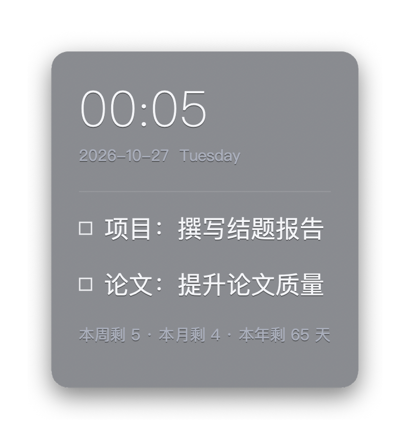

<h1 align="center">DesktopTip</h1>

<p align="center"><b>A lightweight TODO / sticky note pinned to your desktop</b></p>
<p align="center">One plain text file, one translucent card: clock, date, todos and countdowns, always on your desktop.</p>

<p align="center">
  <a href="README.md">简体中文</a> · <b>English</b>
</p>

<p align="center">
  <a href="https://github.com/XYoung1201/Desktop-Tips/releases/latest"><b>Download for macOS</b></a> ·
  <a href="#quick-start"><b>Quick start</b></a> ·
  <a href="#todotxt-syntax"><b>TODO syntax</b></a> ·
  <a href="https://github.com/XYoung1201/Desktop-Tips/issues"><b>Issues</b></a>
</p>

<p align="center">
  
  
  
  
</p>

<p align="center">
  
</p>
<p align="center"><sub>The macOS card: large clock, grey date line, checkable todos and auto-computed days remaining.</sub></p>

DesktopTip is a sticky-note / todo widget that lives on your desktop. It reads an ordinary text file (`TODO.txt` by default) and renders it as a translucent rounded card. Edit the file with any editor and the card follows; click a checkbox to mark an item done and sink it to the bottom of the list.

It keeps the few things that matter today, plus countdowns and date info, in front of you. No account, no cloud, no database: your content is just a `.txt` file. Windows and macOS each have a native implementation, and **both share the same TODO file format and config keys**, so one file works on both.

## Contents

- [Features](#features)
- [Platforms and downloads](#platforms-and-downloads)
- [Quick start](#quick-start)
- [TODO.txt syntax](#todotxt-syntax)
- [Interface and controls](#interface-and-controls)
- [Countdown and alarm](#countdown-and-alarm)
- [Configuration](#configuration)
- [Platform differences](#platform-differences)
- [FAQ](#faq)
- [Build from source](#build-from-source)
- [Feedback and contributing](#feedback-and-contributing)

## Features

| Feature | What you can do | Why it helps |
|---|---|---|
| Plain-text driven | Maintain `TODO.txt` with any editor; the card refreshes automatically. Point it at any other text file at any time | Your data stays yours; drop it in a cloud drive or version control |
| One-click check-off | Clicking a checkbox adds / removes a trailing `_OK`; finished items sink and show a strikethrough | Complete items without opening the file; it stays readable plain text |
| Dynamic placeholders | Write `{{TIME}}`, `{{DATE}}`, `{{DAYS_LEFT_YEAR}}` and more; they are replaced on render | One card is a clock, calendar and progress reminder at once |
| Translucent card | Rounded corners, soft shadow, hairline border; font size, spacing, opacity, colors and font are adjustable | Blends into the wallpaper yet stays legible |
| Two display modes | "Attach to desktop" stays on the desktop layer; "Always on top" floats above every window | Pick the persistence that fits your workflow |
| Countdown and alarm | 1 / 5 / 10 min, 1 hour or custom, with optional repeat; or set an alarm time | Pomodoro, meeting and timed reminders in one place |
| Full-screen alert | A full-screen animation when time is up; click or press a key to stop | Hard to miss, easy to dismiss |
| Position memory | Drag the card anywhere; position and style are saved and restored | Arrange once, keep it |

## Platforms and downloads

| Platform | Requirements | How to get it |
|---|---|---|
| macOS | macOS 13+, Apple silicon and Intel (universal) | Download `DesktopTip-macOS.zip` from [Releases](https://github.com/XYoung1201/Desktop-Tips/releases/latest), unzip and open `DesktopTip.app` |
| Windows | Windows 10 / 11 | Open `DesktopTip.sln` in Visual Studio and build it; see [Build from source](#build-from-source) |

The macOS build is ad-hoc signed. If Gatekeeper blocks the first launch, **right-click → Open** in Finder once. There is no Dock icon; a checklist icon appears in the menu bar, and right-clicking the card opens the same menu.

## Quick start

1. Launch DesktopTip. On first run it creates a sample `TODO.txt` and the card appears on the desktop.
2. **Double-click the card** (or choose "Edit TODO" from the menu) to open the file in your default editor, add your own content following the [syntax below](#todotxt-syntax), and save. The card updates.
3. Click the box in front of an item to complete it; click again to undo.
4. Drag the card to where you want it.
5. Right-click the card and choose "Settings…" to adjust font size, spacing, opacity, colors and font; use "Countdown" or "Alarm" for timers.

Default locations:

| Platform | TODO file | Config file |
|---|---|---|
| macOS | `~/Library/Application Support/DesktopTip/TODO.txt` | `~/Library/Application Support/DesktopTip/config` |
| Windows | `TODO.txt` in the program directory | `C:\ProgramData\DesktopTip\config` |

To use an existing file, choose "Change TODO file" in the menu; the path is stored in the config.

## TODO.txt syntax

The leading symbol of each line decides its role on the card:

| Syntax | Role | Rendering |
|---|---|---|
| `# text` | Large heading | Big light-weight text, often used for the clock |
| `> text` | Secondary note | Small grey text, good for the date or a footer |
| `- text` (or `* text`, or plain text) | Todo | A line with a checkbox |
| Trailing `_OK` | Done marker | Checked, dimmed, struck through, sorted after open items |
| Blank line | Spacer | A bit of vertical space |

A divider is drawn automatically between the content above and the todo section. Example:

```text
# {{TIME}}
> {{DATE}}  {{WEEK}}
- Project: write the final report
- Paper: improve the manuscript_OK
> {{DAYS_LEFT_WEEK}} days left this week · {{DAYS_LEFT_MONTH}} this month · {{DAYS_LEFT_YEAR}} this year
```

**Placeholders** (usable on any line, replaced on render):

| Placeholder | Meaning |
|---|---|
| `{{TIME}}` | Current time, `HH:MM` |
| `{{DATE}}` | Current date, `YYYY-MM-DD` |
| `{{WEEK}}` | Day of the week |
| `{{MONTH}}` | Month name |
| `{{YEAR}}` | Year |
| `{{DAYS_LEFT_WEEK}}` | Days left in the week (Sunday ends the week) |
| `{{DAYS_LEFT_MONTH}}` | Days left in the month |
| `{{DAYS_LEFT_YEAR}}` | Days left in the year |

Unknown placeholders are left untouched. Files may be UTF-8 (with or without BOM), UTF-16 or legacy encodings such as GBK on read; the app always writes UTF-8.

## Interface and controls

| Action | Effect |
|---|---|
| Click a checkbox | Toggle completion, write back to the file and re-sort |
| Drag the card | Move it; the position is remembered |
| Double-click the card | Open the TODO file in the default editor |
| Right-click the card | Open the menu (on macOS the menu-bar icon works too) |

Menu items:

| Item | Description |
|---|---|
| Settings… | Panel for font size, spacing, card opacity, text color, card color and font; changes apply live |
| Countdown | 1 min / 5 min / 10 min / 1 hour / custom, plus a "Repeat" toggle |
| Alarm… | Enter `HH:MM` or `HH:MM:SS`; a time already passed means tomorrow |
| Cancel countdown / alarm, Stop alert | Shown only while armed or alerting, with the remaining time |
| Display mode | Attach to desktop / Always on top |
| Edit TODO, Refresh, Change TODO file | File operations; the card also refreshes on a timer (every minute on Windows, checked every second on macOS) |
| Quit | Save the position and exit |

## Countdown and alarm

- **Countdown** accepts minutes, `MM:SS` or `HH:MM:SS`. With "Repeat" on, the next round starts automatically each time it fires.
- **Alarm** sets a specific time of day; if it has already passed today, it moves to tomorrow.
- When time is up a full-screen alert appears: on macOS a bouncing card that keeps changing fonts, with a sound; on Windows a black-hole lensing animation. Click or press any key to stop, or choose "Stop alert" from the menu.
- Only one countdown / alarm is active at a time; setting a new one replaces the old.

## Configuration

The config is a `key: value` text file, one entry per line. The app writes it when you move the card or change style; you can also edit it by hand and restart.

| Key | Meaning | Default |
|---|---|---|
| `Window_X` / `Window_Y` | Top-left position of the card | Set on first run |
| `TODO_path` | Path of the TODO file | See [Quick start](#quick-start) |
| `FontHeight` | Body font size in pixels | `24` |
| `LineHeight` | Line spacing parameter; the part above the font size becomes extra spacing | `36` |
| `TextColor_R/G/B` | Text color | `244, 245, 248` |
| `BgColor_R/G/B` | Card color | `20, 25, 35` |
| `BgAlpha` | Card opacity, 0–255 | `128` |
| `FontFamily` | Font name | macOS: `PingFang SC`; Windows: `Microsoft YaHei UI` |
| `DisplayMode` | `0` attach to desktop, `1` always on top | `0` |
| `CountdownRepeat` | Repeat countdowns, `0` / `1` | `0` |

Both platforms use the same keys. `Window_X/Y` depends on each system's screen coordinates, so don't copy the config file between machines; copying the TODO file is fine.

## Platform differences

| Item | Windows | macOS |
|---|---|---|
| Implementation | C++ / Win32 / GDI+ | Swift / AppKit |
| Attach to desktop | Sits on the wallpaper layer; `Win+D` does not minimize it | Above desktop icons, below normal windows, visible on every Space |
| Always-available entry | System tray icon | Menu-bar icon |
| Editing the file | Notepad | The system default text editor |
| Full-screen alert | Black-hole lensing animation | Bouncing alert card + sound |
| Font selection | Font dialog from the menu | Font drop-down in the settings panel |

## FAQ

**The card disappeared or moved off screen?**
The card is pulled back into the visible area on launch and when the display layout changes. If you still can't see it, check the display mode: an "Attach to desktop" card is covered by normal windows; move them aside or switch to "Always on top".

**What happens to the file when I tick an item?**
Only a trailing `_OK` is added or removed, and finished items are moved after open ones. Headings, notes and blank lines are kept as they are.

**Can several computers share one TODO?**
Yes. Put `TODO.txt` in a synced folder and point "Change TODO file" on each machine at it; the same file looks the same on Windows and macOS.

**Does the clock update by itself?**
Yes. Windows re-renders every minute and macOS checks every second, so placeholders like `{{TIME}}` stay current; you can also choose "Refresh" at any time.

**macOS says the developer can't be verified?**
That is expected with ad-hoc signing: right-click `DesktopTip.app` in Finder, choose "Open", and confirm once.

## Build from source

### macOS

Requires the Xcode Command Line Tools (`xcode-select --install`):

```bash
cd macOS
./build.sh
open build/DesktopTip.app
```

The script builds Apple-silicon and Intel slices (only the host architecture if the Intel toolchain is unavailable), generates the icon and ad-hoc signs the bundle. Output: `macOS/build/DesktopTip.app`. The source is the single file [`macOS/main.swift`](macOS/main.swift).

### Windows

1. Open `DesktopTip.sln` in Visual Studio 2019 / 2022;
2. Build the x64 / Release configuration to produce `DesktopTip.exe`;
3. Run it. On first launch a default `TODO.txt` is created next to the program.

## Feedback and contributing

Please report problems and ideas in [Issues](https://github.com/XYoung1201/Desktop-Tips/issues); pull requests are welcome. When reporting, include your platform and OS version and, if relevant, the TODO snippet or config involved.
