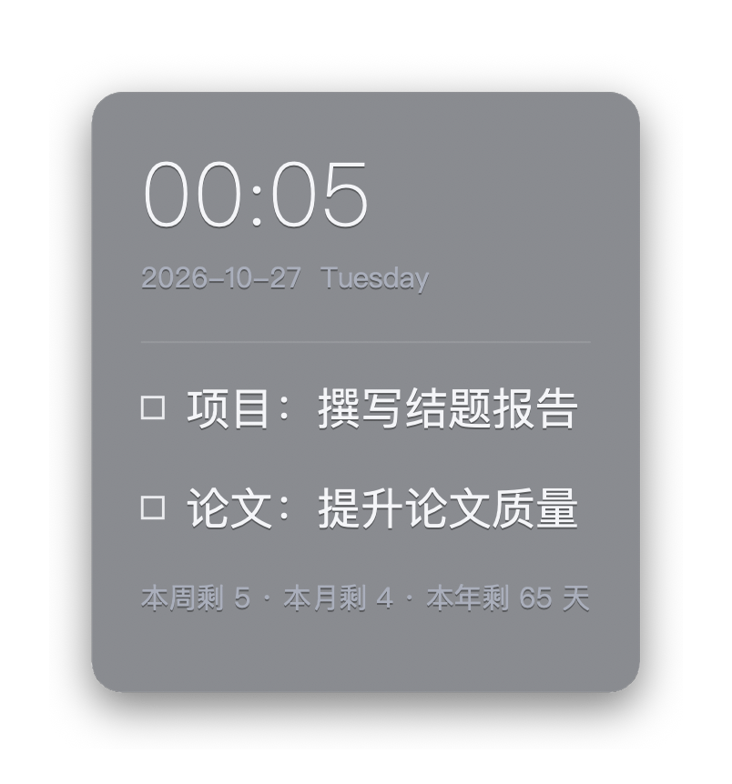

<h1 align="center">DesktopTip</h1>

<p align="center"><b>A lightweight TODO / sticky note pinned to your desktop</b></p>
<p align="center">One plain text file, one translucent card: clock, date, todos and countdowns, always on your desktop.</p>

<p align="center">
  <a href="README.md">简体中文</a> · <b>English</b>
</p>

<p align="center">
  <a href="https://github.com/XYoung1201/Desktop-Tips/releases/latest"><b>Download for Windows / macOS</b></a> ·
  <a href="#quick-start"><b>Quick start</b></a> ·
  <a href="#todotxt-syntax"><b>TODO syntax</b></a> ·
  <a href="https://github.com/XYoung1201/Desktop-Tips/issues"><b>Issues</b></a>
</p>

<p align="center">
  
  
  
  
</p>

<p align="center">
  
</p>
<p align="center"><sub>The macOS card: large clock, grey date line, checkable todos and auto-computed days remaining.</sub></p>

DesktopTip is a sticky-note / todo widget that lives on your desktop. It reads an ordinary text file (`TODO.txt` by default) and renders it as a translucent rounded card. Edit the file with any editor and the card follows; click a checkbox to mark an item done. Group with `##`, set deadlines with `@time`; it stays quietly on the desktop and surfaces gently when something is due.

It keeps the few things that matter today, plus countdowns and date info, in front of you. No account, no cloud, no database: your content is just a `.txt` file. Windows and macOS each have a native implementation, and **both share the same TODO file format and config keys**, so one file works on both.

## Contents

- [Features](#features)
- [Platforms and downloads](#platforms-and-downloads)
- [Quick start](#quick-start)
- [TODO.txt syntax](#todotxt-syntax)
- [Groups: fold, hide and pin](#groups-fold-hide-and-pin)
- [Deadlines and countdowns](#deadlines-and-countdowns)
- [Display modes and smart surfacing](#display-modes-and-smart-surfacing)
- [Interface and controls](#interface-and-controls)
- [Configuration](#configuration)
- [Platform differences](#platform-differences)
- [FAQ](#faq)
- [Build from source](#build-from-source)
- [Feedback and contributing](#feedback-and-contributing)

## Features

| Feature | What it does | Why it helps |
|---|---|---|
| Plain-text driven | Maintain `TODO.txt` in any editor; the card refreshes automatically | Your content stays yours, ready for sync folders or version control |
| Nested groups | `##` level 1, `###` level 2, and so on; groups can be folded (`_FOLD`) or hidden (`_HIDE`), and a single task can stay visible with `_SHOW` | However much you track, the card shows only what you need now |
| One-click check-off | Click the round checkbox to add/remove `_OK`; the task **stays in place** (optional "sink completed") | Finish items without opening the file, which stays readable |
| Deadline countdowns | Tasks and standalone countdowns take a deadline, entered either as a date-time (Y-M-D h:m:s) or as time remaining (months/days/hours/minutes/seconds), switchable; both are stored as `@YYYY-MM-DD HH:MM:SS` in the file | A countdown is just text in your file, surviving restarts and machine changes |
| Smart surfacing | Stays on the desktop out of your way; rises as a translucent, click-through overlay when a deadline is near or for a periodic glance | Solves "always-on-top is intrusive, but otherwise I never see it" |
| Live placeholders | `{{TIME}}`, `{{DATE}}`, `{{DAYS_LEFT_YEAR}}`, … are replaced when rendering | One card is a clock, calendar and progress reminder |
| Minimal card | Translucent rounded card with soft shadow and top sheen, thin-line icons, minimal timer pills; size, spacing, colours and font adjustable | Blends with your wallpaper yet stays readable |
| Position memory | Drag the card anywhere; restored on restart | Place it once |

## Platforms and downloads

| Platform | Requirements | How to get it |
|---|---|---|
| macOS | macOS 13+, Apple silicon and Intel | Download `DesktopTip-macOS.zip` from [Releases](https://github.com/XYoung1201/Desktop-Tips/releases/latest) and open `DesktopTip.app` |
| Windows | Windows 10 / 11, x64 | Download `DesktopTip-windows-x64.zip` from [Releases](https://github.com/XYoung1201/Desktop-Tips/releases/latest) and run `DesktopTip.exe`, or [build from source](#build-from-source) |

The macOS build is ad-hoc signed. If macOS blocks the first launch, **right-click → Open** in Finder once. There is no Dock icon; use the menu-bar icon or right-click the card.

## Quick start

1. Launch DesktopTip. On first run it creates a sample `TODO.txt`.
2. **Double-click the card** (or menu "编辑 TODO") to open the file, edit it using the [syntax below](#todotxt-syntax), and save.
3. Click the circle before a task to complete it; click a group header to fold/unfold it.
4. Right-click a task to set a deadline; right-click empty space for a new countdown.
5. Drag the card into place; right-click → "外观设置…" for size, spacing, opacity, colours and font.

Default locations:

| Platform | TODO file | Config | Deadline state |
|---|---|---|---|
| macOS | `~/Library/Application Support/DesktopTip/TODO.txt` | `…/DesktopTip/config` | `…/DesktopTip/deadlines` |
| Windows | `TODO.txt` next to the executable | `C:\ProgramData\DesktopTip\config` | `C:\ProgramData\DesktopTip\deadlines` |

## TODO.txt syntax

The **start** of a line sets its role; **trailing markers** set its state (any order, space-separated):

| Line start | Role |
|---|---|
| `# text` | Large heading (great for a clock); also closes all groups |
| `> text` | Secondary note (small grey text) |
| `## name` | Level-1 group; `### name` level 2, `####` level 3, … |
| `##` alone | Closes all groups; `###` alone closes level 2 and deeper |
| `! name @deadline` | Standalone countdown; a `!` line without a deadline is a normal todo |
| `- text`, `* text` or plain text | Todo |
| Empty line | Spacer |

| Trailing marker | Effect |
|---|---|
| `_OK` | Done: checked, faded, struck through |
| `_FOLD` | (group) Folded: shows only the header plus an "N items · nearest due" summary |
| `_HIDE` | Hides the group (with everything in it) or the task |
| `_SHOW` | (task/countdown) Stays visible even when its group is folded or hidden |
| `@2026-12-31 18:00:00` | Deadline; a date alone means 23:59:59, minutes-only also works |
| `/30m` | Repeat after firing (units `s` `m` `h` `d`); the deadline moves forward automatically |

Example:

```text
# {{TIME}}
> {{DATE}}  {{WEEK}}
## Work
- Final report @2026-12-05 18:00:00
### Paper
- Extra experiments
- Revise intro _OK
- Reply to reviewers @2026-12-01 _SHOW
## Home _FOLD
- Pay electricity @2026-11-30
##
! Pomodoro @2026-11-27 15:25:00 /25m
> {{DAYS_LEFT_YEAR}} days left this year
```

**Placeholders**: `{{TIME}}` (HH:MM), `{{DATE}}` (YYYY-MM-DD), `{{WEEK}}`, `{{MONTH}}`, `{{YEAR}}`, `{{DAYS_LEFT_WEEK}}`, `{{DAYS_LEFT_MONTH}}`, `{{DAYS_LEFT_YEAR}}`. Unknown placeholders are left as is.

Files in UTF-8 (with or without BOM), UTF-16 and legacy encodings such as GBK can be read; writes are always UTF-8. Files from older versions work unchanged.

## Groups: fold, hide and pin

- **Click a group header** to fold/unfold it (written as `_FOLD`). A folded header shows "N items · nearest deadline", in coral if overdue.
- Right-click a group → hide writes `_HIDE`. Enable "显示隐藏的条目" (show hidden items) to see hidden content faded so you can unhide it.
- To keep an eye on a few tasks inside a collapsed group, right-click them and tick "分组折叠 / 隐藏时仍显示" (`_SHOW`). They remain checkable; checking only appends `_OK` and **does not move the line**.
- Prefer completed items to sink to the end of their group? Turn on "已完成项沉底" (off by default).

## Deadlines and countdowns

Task countdowns and standalone countdowns are one mechanism: **always stored as a deadline in the TODO file**.

- **Set**: right-click a task → set deadline, or right-click empty space → new countdown. The dialog has two switchable pages: **Deadline** (year, month, day, hour, minute, second) and **Remaining** (months / days / hours / minutes / seconds). They convert live, a preview shows the resulting deadline, and you can tick "repeat".
- **Quick countdown**: presets from 5 to 90 minutes, also converted to a deadline.
- **Display**: a thin ring pill shows time remaining; amber when near, coral when overdue. **Click the pill** to toggle between remaining time and the deadline itself.
- **On expiry**: the card comes to the front with a gentle shake and a banner — tasks offer Done / +5 min / OK, countdowns +5 min / OK. A non-repeating standalone countdown is removed on OK; a task keeps its deadline and shows as overdue.
- **Stopwatches** are still per task (start / pause / restart / remove from the task menu; click the pill to pause/resume).

Countdowns from older versions are converted to deadlines on startup; the old alarm / global countdown is merged into standalone countdowns.

## Display modes and smart surfacing

| Mode | Behaviour |
|---|---|
| **Smart surfacing** (recommended, default for new installs) | Lives on the desktop and never covers your windows. It rises only when something matters: when a deadline enters the lead time (default 10 min) until it is handled or fires, and — if anything is open — for an 8-second glance every so often (default 45 min). While surfaced the card is **translucent, never takes focus and lets clicks pass through**; hovering makes it fainter, and holding Ctrl (⌘ on macOS) makes it solid and interactive. It stays down while a full-screen app or presentation is in front (expiry alerts excepted). |
| Attach to desktop | Always on the desktop layer, covered by normal windows; on Windows `Win+D` does not hide it. |
| Always on top | Above all windows; optional "hide on hover" fades it and lets clicks through. |

Lead time (5 / 10 / 15 / 30 min) and periodic glance (30 / 45 / 60 min / off) are in the display-mode submenu. Expiry alerts bring the card to the front in every mode.

## Interface and controls

| Action | Effect |
|---|---|
| Click the circle before a todo | Toggle done (`_OK`) |
| Click a group header | Fold / unfold |
| Click a timer pill | Deadline: toggle remaining/deadline; stopwatch: pause/resume |
| Drag the card | Move it; position is saved |
| Double-click the card | Open the TODO file in the default editor |
| Right-click | Menu; on a row, row-specific actions appear first |

## Configuration

The config file is `key: value` per line, written automatically; manual edits take effect on restart.

| Key | Meaning | Default |
|---|---|---|
| `Window_X` / `Window_Y` | Card top-left position | Automatic on first run |
| `TODO_path` | TODO file path | See [Quick start](#quick-start) |
| `FontHeight` / `LineHeight` | Body size / line spacing (px) | `24` / `36` |
| `TextColor_R/G/B`, `BgColor_R/G/B` | Text and card colours | `244,245,248`, `20,25,35` |
| `BgAlpha` | Card opacity, 0–255 | `128` |
| `FontFamily` | Font name | macOS `PingFang SC`; Windows `Microsoft YaHei UI` |
| `DisplayMode` | `0` desktop, `1` always on top, `2` smart surfacing | `2` for new installs; existing configs keep theirs |
| `SurfaceLead` | Smart surfacing: minutes before a deadline to surface | `10` |
| `SurfaceEvery` | Smart surfacing: glance interval in minutes, `0` off | `45` |
| `HoverHide` | Hide on hover when always on top | `1` |
| `ShowHidden` | Show `_HIDE` items faded | `0` |
| `SinkCompleted` | Sink completed items to the end of their group | `0` |
| `DueDisplay` | Deadline pill shows `0` remaining / `1` deadline | `0` |
| `DueInputMode` | Countdown dialog opens on `0` deadline / `1` remaining | `1` |
| `CountdownRepeat` | Default for "repeat" in the new-countdown dialog | `0` |

The `deadlines` file only records when each deadline was set (for the progress ring) and whether it has fired; the deadline itself always lives in the TODO file. Both platforms use the same keys; `Window_X/Y` depend on each system's screen coordinates, so share the TODO file rather than the config.

## Platform differences

| Item | Windows | macOS |
|---|---|---|
| Implementation | C++ / Win32 / GDI+ | Swift / AppKit |
| Attach to desktop | On the wallpaper layer; `Win+D` does not minimise it | Above desktop icons, below normal windows, on all Spaces |
| Interact with surfaced card | Hold Ctrl | Hold ⌘ |
| Resident entry | Tray icon | Menu-bar icon |
| Font picker | Font dialog from the menu | Font list in the settings panel |

## FAQ

**The card disappeared / is off-screen?**
It is pulled back on startup and when the display layout changes. In desktop and smart-surfacing modes normal windows cover it by design; it surfaces when a deadline approaches.

**What happens to the file when I check an item?**
Only `_OK` is added or removed at the end of that line; the line does not move (unless "sink completed" is on).

**Where are deadlines stored?**
In the `@…` part of the line in your TODO file, so they travel with the file.

**Can several computers share one TODO?**
Yes. Put `TODO.txt` in a synced folder and point each machine at it.

**macOS says it cannot verify the developer?**
Right-click `DesktopTip.app` in Finder and choose Open once.

## Build from source

### macOS

Requires the Xcode Command Line Tools (`xcode-select --install`):

```bash
cd macOS
./build.sh
open build/DesktopTip.app
```

The script builds Apple-silicon and Intel slices (only the host architecture if the Intel toolchain is unavailable), generates the icon and ad-hoc signs the bundle. Output: `macOS/build/DesktopTip.app`. The source is the single file [`macOS/main.swift`](macOS/main.swift).

### Windows

1. Open `DesktopTip.sln` in Visual Studio 2019 / 2022;
2. Build the x64 / Release configuration to produce `DesktopTip.exe` (the `build-windows.yml` GitHub Actions workflow builds the same artifact in the cloud);
3. Run it. On first launch a default `TODO.txt` is created next to the program.

## Feedback and contributing

Please report problems and ideas in [Issues](https://github.com/XYoung1201/Desktop-Tips/issues); pull requests are welcome. When reporting, include your platform and OS version and, if relevant, the TODO snippet or config involved.
